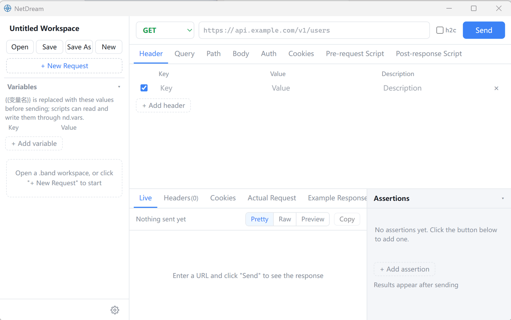

#  NetDream! It's MyGO!!!!!

**An offline Postman alternative built with [MyGO](https://github.com/egoist/mygo)**

[](https://github.com/kisaragychihaya/NetDream/releases)

中文版：[README.md](README.md)

NetDream is a desktop API debugging tool: a Go backend that talks to the wire directly, rendered in the system webview — no Electron, no cloud, no account. Fully offline.



## Features

- **HTTP debugging**: methods / headers / query / path params / body (form-data text and **file** fields, urlencoded, raw, binary), Basic / Bearer auth, cookies, timeouts
- **HTTP/2**: ALPN negotiation on `https://`, forced h2c on `http://`, response protocol visible
- **SSE streaming**: live event table, stop anytime
- **WebSocket / TCP debugging**: connect / disconnect, handshake headers / query params / subprotocols, message templates (Text / JSON / XML / HTML / Binary), live send/receive log, handshake response headers
- **Socket.IO debugging**: Socket.IO v3 / v4 / v5 (EIO4) and v2 (EIO3), URL path as namespace, configurable handshake path, event name + ack on send, per-event listen filtering (no reconnect needed)
- **Response view**: prettify (JSON / HTML syntax highlighting), raw body, sandboxed HTML preview, one-click copy
- **Assertions panel**: status code, contains / not-contains, response time
- **Pre / post scripts**: executed by a goja engine — pre scripts can rewrite the request, post scripts can assert on the response, both can read/write variables; console output lands in the "Console" tab, assertions in the assertions panel
- **Variables**: editable in the sidebar; `{{name}}` placeholders in URL / headers / body are substituted before sending, and scripts share the same store via `nd.vars`
- **Markdown documents**: created from the sidebar "New" menu and registered immediately, edited with Vditor in Typora-style instant rendering; the title is edited right in the top bar; content persists as a `.band` entry, fully offline
- **Request grouping**: nested folders in the sidebar, drag to organize, deleting a folder promotes its contents one level, collapse state remembered (not persisted)
- **Interface**: 中文 / English / 日本語 with a follow-system option; light / dark / follow-system theme; settings page with about & version info
- **System proxy**: HTTP/SSE and WS/Socket.IO honor env vars → system proxy, bypass configurable; TCP connects directly
- **Workspaces (.band)**: open / save / save-as; drop a `.band` file on the window to open it (dropping onto a form-data file field fills that row instead); executing a request registers it in the in-memory workspace automatically (success or failure), editing method / URL and re-executing forks a new entry, custom names stick; unsaved-changes guard before closing / new / open. Archive format details: [docs/architecture.md](docs/architecture.md)
- **Auto-save**: registering on connect, refreshed on disconnect; saving writes the whole in-memory workspace to disk

## Scripts (pre / post)

Each request can carry two pieces of JavaScript: a pre script (runs before sending;
may rewrite the request and read/write variables) and a post script (runs once the
response arrives; meant for assertions, extracting variables and logging). They run
on a goja engine with a synchronous API and a 5-second timeout, and work together
with the sidebar variable table and `{{name}}` substitution.

**Full authoring guide (Chinese, API reference + examples): [docs/scripts.md](docs/scripts.md)**

## Tech stack

- [MyGO](https://github.com/egoist/mygo): Go backend + system webview, services bound with `mygo.Bind`, frontend types generated by `mygo generate`
- Script engine: [goja](https://github.com/dop251/goja) (pure Go, no CGO)
- Frontend: vanilla TypeScript (strict; runtime dependencies limited to the monaco-editor script editor and the Vditor Markdown editor) + Vite, UI modeled after the ApiPost debug page
- Contract doc: [`docs/architecture.md`](docs/architecture.md)

## Quick start

Requires [Go](https://go.dev/), [Bun](https://bun.sh/) and MyGO's platform dependencies (see `mygo doctor`).

```bash
bun install                  # mygo-cli
bun install --cwd frontend   # vite / typescript / monaco-editor / vditor
bun run dev                  # dev mode (hot reload; predev syncs Vditor's offline assets into frontend/public/vditor)
```

Helper scripts:

```bash
bun run generate      # regenerate the frontend IPC bindings (frontend/src/mygo.ts)
bun run typecheck     # frontend type check
bun run sse:demo      # local SSE test server (http://localhost:8123/sse)
bun run socket:demo   # local WS/TCP echo servers (ws://localhost:8124, tcp://localhost:8125)
bun run socketio:demo # local Socket.IO demo server (http://localhost:6021/, namespace /admin)
```

## Build

```bash
bun run build                                    # current platform, output in build/
bunx mygo build -platform darwin/arm64           # cross-compilation (MyGO needs no cgo)
bunx mygo build -platform windows/amd64 -skip-installer
```

## Known limitations

- Workspace path is not remembered across restarts; only the editor draft is restored, the list comes back by reopening a .band
- No search in the sidebar list; sibling order is adjusted by dragging into a folder / the root tail (no same-level drag handles)
- Markdown has no math, image upload, recording or export (runtime assets are localized on demand; exotic diagram blocks render as plain code blocks)
- The "response example" tab is a placeholder

## License

[MIT](LICENSE)
