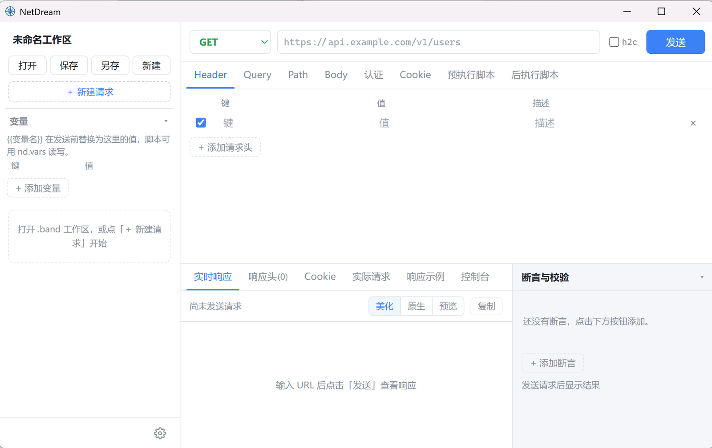

#  NetDream! It's MyGO!!!!!

**一个使用 [MyGO](https://github.com/egoist/mygo) 开发的 Postman 离线替代品**

[](https://github.com/kisaragychihaya/NetDream/releases)

English: [README.en.md](README.en.md)

NetDream 是一个跑在桌面上的 API 调试工具：Go 后端直接发包，系统 webview 渲染界面——没有 Electron，没有云端，没有账号，完全离线。

~~解压完才50M，我的内存和硬盘再也不会咕咕嘎嘎啦~~



## 特性

- **HTTP 调试**：方法 / Header / Query / Path 参数 / Body（form-data 文本与**文件**字段、urlencoded、raw、binary）、Basic / Bearer 认证、Cookie、超时
- **HTTP/2**：`https://` 自动协商，`http://` 可强制 h2c，响应协议版本可见
- **SSE 流式响应**：事件实时列表、随时停止
- **WebSocket / TCP 调试**：连接 / 断开、握手请求头 / 查询参数 / 子协议、消息模板（Text / JSON / XML / HTML / Binary）、实时收发日志、握手响应头
- **Socket.IO 调试**：Socket.IO v3 / v4 / v5（EIO4）与 v2（EIO3）、URL 路径即命名空间、握手路径可配、发送带事件名与 Ack、按事件勾选监听（切换免重连）
- **响应视图**：美化（JSON / HTML 语法高亮）、原始报文、HTML 沙箱预览、一键复制；响应示例可把当前响应一键存入请求条目（.band 落盘），方便后续查看对比
- **断言面板**：状态码、包含 / 不包含、响应耗时
- **预 / 后执行脚本**：goja 引擎执行——预脚本可改写请求、后脚本可断言响应，读写变量，日志进「控制台」页签、断言进断言面板
- **变量**：侧栏可视化编辑，URL / Header / Body 等处 `{{变量名}}` 发送前替换，脚本经 `nd.vars` 读写同一份数据
- **Markdown 文档**：侧栏「新建」即入册，Vditor 即时渲染（Typora 式），文档名顶栏直改；内容随 .band 条目落盘，离线可用
- **请求分组**：侧栏多级文件夹，拖拽归类、删除内容上移一级，折叠记忆（不落盘）
- **界面**：中文 / English / 日本語 + 跟随系统；浅色 / 深色 / 跟随系统主题；设置页含关于与版本信息
- **系统代理跟随**：HTTP/SSE 与 WS/Socket.IO 走环境变量 → 系统代理，bypass 可配；TCP 直连
- **工作区（.band）**：打开 / 保存 / 另存为；拖到窗口直接打开（落在 form-data 文件字段上则填入该行）；请求执行即自动入册内存工作区（成败都收），method / URL 变更后执行自动派生新条目，别名保留；关窗 / 新建 / 打开前未保存守卫。归档格式解析见 [docs/architecture.md](docs/architecture.md)
- **自动保存**：连接建立即入册，断开后自动刷新，保存 = 内存工作区整体落盘

## 脚本（预执行 / 后执行）

每个请求可挂两段 JavaScript：预执行脚本（发送前，可改写请求 / 读写变量）与
后执行脚本（拿到响应后，可断言 / 提取变量 / 打日志），经 goja 执行、同步 API、
5 秒超时；配合侧栏变量区与 `{{变量名}}` 替换使用。

**完整编写指南（API 参考 + 范例）：[docs/scripts.md](docs/scripts.md)**

## 技术栈

- [MyGO](https://github.com/egoist/mygo)：Go 后端 + 系统 webview，绑定用 `mygo.Bind`，前端类型由 `mygo generate` 生成
- 脚本引擎：[goja](https://github.com/dop251/goja)（纯 Go，无 CGO）
- 前端：原生 TypeScript（strict；运行时依赖仅脚本编辑器 monaco-editor 与 Markdown 编辑器 Vditor）+ Vite，UI 参照 ApiPost 调试页
- 契约文档：[`docs/architecture.md`](docs/architecture.md)

## 快速开始

需要 [Go](https://go.dev/)、[Bun](https://bun.sh/) 和 mygo 的平台依赖（见 `mygo doctor`）。

```bash
bun install                  # 安装 mygo-cli
bun install --cwd frontend   # 安装 vite / typescript / monaco-editor / vditor
bun run dev                  # 开发模式（热重载；predev 自动把 Vditor 离线资源同步进 frontend/public/vditor）
```

辅助脚本：

```bash
bun run generate      # 重新生成前端 IPC 绑定（frontend/src/mygo.ts）
bun run typecheck     # 前端类型检查
bun run sse:demo      # 本地 SSE 测试服务器（http://localhost:8123/sse）
bun run socket:demo   # 本地 WS/TCP 回显服务器（ws://localhost:8124，tcp://localhost:8125）
bun run socketio:demo # 本地 Socket.IO 演示服务器（http://localhost:6021/，命名空间 /admin）
```

## 构建

```bash
bun run build                                    # 当前平台，产物在 build/
bunx mygo build -platform darwin/arm64           # 交叉构建（MyGO 不需要 cgo）
bunx mygo build -platform windows/amd64 -skip-installer
```

## 已知限制

- 工作区路径不跨重启记忆；重启只恢复编辑区草稿，列表需重新打开 .band
- 侧栏列表暂无搜索；同级顺序靠拖入文件夹 / 根目录尾部调整（无同级拖动手柄）
- Markdown 暂不支持数学公式、图片上传、录音与导出（运行时资源按需本地化，冷门图表块按普通代码块显示）
- 响应示例每条请求只保存一份（列表结构已为多示例扩展预留）

## License

[MIT](LICENSE)
